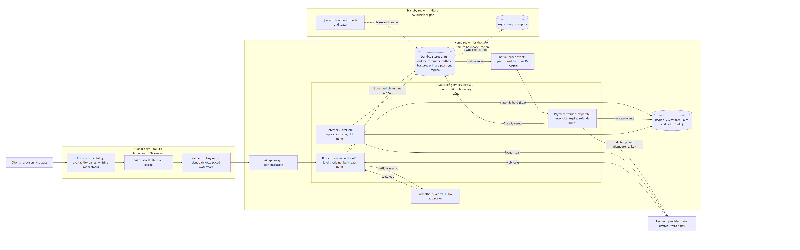

# High-level design

Source: [hld.mmd](hld.mmd) (Mermaid). Export: [hld.png](hld.png).

## Walkthrough

1. **Edge.** Clients hit the CDN first. Catalog pages, availability bands and waiting room status are cached there, so most of the 500,000 requests/sec never reach origin. The WAF and bot scoring filter abuse, and the waiting room hands out signed tickets and admits users at a paced rate. This whole box is bought, not built, and it is its own failure boundary: if the CDN vendor fails, the sale cannot run.
2. **Gateway.** Authenticates users and applies per-user rate limits.
3. **Reservation, step 1.** The API runs one Lua script on a Redis bucket that pops a free unit and records the hold atomically. The user gets a signed hold token. No database write happens here, which keeps the hot path fast.
4. **Order creation, step 2.** When the user pays, the API verifies the token and runs one durable transaction: a guarded update moves the unit from FREE to RESERVED, and the order, the payment attempt and an outbox entry are written together. The client gets `202` and polls.
5. **Payment, steps 3 and 4.** The worker picks the attempt from the outbox, marks it UNKNOWN, and calls the provider with the attempt ID as idempotency key. No transaction is open during the call.
6. **Settlement, step 5.** Worker responses, provider webhooks and the reconciler all apply results through one state machine, so duplicates and races settle on one outcome. Release events return freed units to Redis with a version check.
7. **Detectors.** Independent jobs compare the durable store, Redis and the provider ledger, and alert on oversell, duplicate charges, orphan charges, stuck payments and drift.
8. **Observability.** The in-flight request metric feeds the KEDA autoscaler and the alert rules.

## Failure boundaries

| Boundary | What fails | What keeps working |
|---|---|---|
| Edge vendor | CDN, WAF or waiting room | Nothing customer-facing; this is why the edge is bought from a vendor with multi-region capacity |
| Zone | One third of stateless services, one Redis or database replica | Everything, after load balancers and replicas fail over |
| Redis | Holds and the free-unit sets | Paid orders and payments; Redis is rebuilt from the durable store |
| Payment provider | Charges | Holds and orders; units stay reserved and admissions slow until the provider recovers |
| Home region | Everything in the region | Reads from the CDN and replicas; selling resumes in the standby region after fencing |
